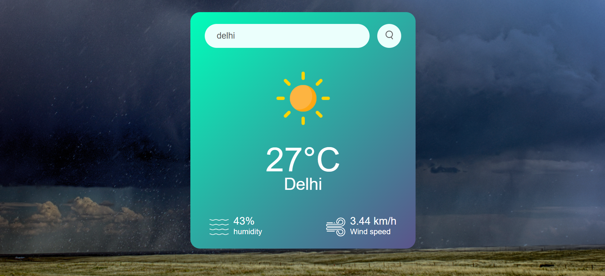

# Weather Website

A responsive weather application built using HTML, CSS, and JavaScript that retrieves real-time weather information using the OpenWeatherMap API.

## Website Preview



## Features

- **City Search:** Search for weather information by entering any city name.
- **Real-Time Weather Data:** Displays current temperature, humidity, and wind speed.
- **Dynamic Weather Icons:** Updates weather icons based on conditions such as clear skies, clouds, rain, drizzle, mist, and snow.
- **Error Handling:** Displays an error message when an invalid city name is entered.
- **Responsive Design:** Adapts the layout for mobile devices and smaller screens.
- **Interactive Interface:** Includes a gradient weather card, custom icons, and a photographic background.

## Technologies Used

- HTML5
- CSS3
- JavaScript
- OpenWeatherMap API

## Project Structure

```text
weather-website/
│
├── img/
│   ├── clear.png
│   ├── clouds.png
│   ├── drizzle.png
│   ├── humidity.png
│   ├── mist.png
│   ├── rain.png
│   ├── search.png
│   ├── snow.png
│   ├── weatherbg.jpg
│   └── wind.png
│
├── preview/
│   └── weather-website-preview.png
│
├── index.html
├── style.css
├── script.js
└── README.md
```

## API Configuration

This project uses the OpenWeatherMap API to retrieve weather information.

To configure the application:

1. Create an account at [OpenWeatherMap](https://openweathermap.org/).
2. Generate your API key.
3. Open `script.js`.
4. Replace the placeholder API key with your own:

```javascript
const apiKey = "[ Your API Key ]";
```

Replace `[ Your API Key ]` with your actual API key.

**Note:** The application requires a valid API key to retrieve weather data.

## How to Run Locally

1. Clone this repository:

```bash
git clone https://github.com/hash1531/weather-website.git
```

2. Open the project folder:

```bash
cd weather-website
```

3. Add your OpenWeatherMap API key to `script.js`.

4. Open `index.html` in your browser or use the Live Server extension in Visual Studio Code.

## Author

**Harsh Kumar**

- [GitHub](https://github.com/hash1531)
- [LinkedIn](https://www.linkedin.com/in/harsh-kumar-921246287/)
- Email: harshdps02@gmail.com
